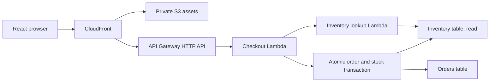

# Application

**Status: designed; not implemented.** This document owns the checkout application’s intended behavior and technical design. It records the design accepted in the planning discussion, including presenter-only access through a shared password. Initial timing and capacity settings still require verification in AWS.

The application is a small React page backed by TypeScript services in us-east-1. Successful checkout saves an order and updates inventory. It belongs to the [reference architecture](../../README.md), alongside the [failure controller](failure-controller.md) and [operations agent](operations-agent.md).

The application produces real operational evidence for the agent-evaluation talk. The audience sees checkout outcomes, failures, latency, and recovery; operating access is presenter-only. The failure controller changes real execution; the operations agent investigates ordinary evidence without receiving the intended diagnosis.

Application telemetry is the evidence the agent investigates. Agent traces are a separate record evaluated afterward. An evaluation may pass while the application remains faulty if the agent handles the incident correctly; see [evaluation approach](../evaluations.md).

## Architecture and rationale

Use API Gateway HTTP API, two TypeScript Lambda functions, two DynamoDB tables, and a React/Vite frontend on private S3 through CloudFront. CDK v2 in TypeScript defines the deployment. A generated shared password checked in the checkout handler controls presenter access.

| Concern | Choice | Reason |
| --- | --- | --- |
| Browser application | React, TypeScript, Vite, one page | Matches the preference and needs no server rendering or application router |
| Static hosting | Private S3 bucket and CloudFront | Familiar AWS components; one frontend origin with managed TLS |
| API | API Gateway HTTP API | Small set of routes, access logs, and request metrics; application checks the credential |
| Business handler | TypeScript Lambda on Node.js 24 | Request-scoped execution with explicit revision and runtime evidence |
| Controlled dependency | Separate read-only inventory lookup Lambda | Real independently timed lookup without a late-writing worker |
| Persistence | On-demand DynamoDB Orders and Inventory tables | Simple keyed records and atomic order/stock updates |
| Identity | Shared generated password; server check and fixed presenter principal | Presenter-only operating access without a separate authentication service |
| Telemetry | Structured CloudWatch logs, native metrics, a few embedded business metrics | Actual request and dependency evidence without another collector service |
| Change history | CloudTrail events plus actual function versions | Real change evidence distinct from private controller labels |
| Infrastructure | CDK v2, TypeScript, one application stack | One language and explicit reusable deployment |
| Local tooling | Node.js 24 and npm workspaces | Keep one package manager and lockfile; avoid another build orchestrator |

HTTP API lacks API Gateway X-Ray tracing. That is a deliberate limitation: request-ID joins and application timing satisfy the current evidence contract. Native traces can be added only if the selected observability demonstration actually needs them; sampled traces must not replace complete request logs. Choose REST API instead if full Gateway X-Ray is made a required demonstration capability.

The strongest complete alternative uses ALB, an ECS Fargate service containing checkout and read-only inventory containers, and RDS PostgreSQL. SQL would provide familiar transaction semantics, but the example would also need VPC/security-group setup, container artifacts, connection handling, credentials, and schema management. The Lambda/DynamoDB design has lower total burden for this bounded, intermittent demonstration. Primary sources are listed below.

## Component arrangement

The browser loads static assets through CloudFront. Its /api requests reach HTTP API and the checkout handler. The handler invokes the inventory lookup Lambda synchronously for a product snapshot and performs the final transaction itself.

The inventory function can read Inventory but cannot write orders or stock. The checkout handler can read orders and perform the required transaction on Orders and Inventory. These functions belong to one application and intentionally share a data model; they are not independent inventory and order microservices.

The lookup has a clear purpose: return server-owned product details, price, and current availability. The final stock condition remains authoritative because availability may change after the read. Keeping the dependency read-only means a slow invocation that outlives its caller cannot create a late order.

## Business scope

Start with one seeded product and a selectable quantity from 1 to 5. Show its name, a demo price, available stock, the checkout result, and recent browser request outcomes. This is a demonstration order flow: no payment collection, delivery, discounts, customer-profile system, shopping cart, or cancellation/refund workflow.

Use integer minor currency units for prices and totals. The browser submits product identity and quantity, never the authoritative price. An order records the product/price snapshot used at checkout. Seeded product details stay fixed within a run; the product data version changes when reset or reseeding invalidates an old snapshot.

The example stays limited to checkout and inventory. A custom incident-management UI, generic fault framework, and automatic remediation are outside this application’s scope.

## Browser behavior

The page shows the product, quantity control, current stock with a last-refreshed time, a checkout button, the last confirmed receipt, and a bounded history of its own requests. Each history row shows start time, outcome, end-to-end duration measured by the browser, and a server request ID when a response supplies one. On a lost response, retain the checkout identity, immutable input, local start time, and uncertainty; do not invent a server request ID.

Selecting checkout creates a new UUID for that logical attempt and captures the catalog's productVersion alongside sku and quantity. Store this immutable payload in session storage before sending it. Disable a second new checkout while that attempt is unresolved. Retrying an uncertain attempt keeps the same identity and input; changing the quantity starts a new logical attempt only after the previous outcome is settled. Reject an unavailable catalog version rather than inventing one. After a destructive reset, discard previous attempts, refresh the catalog, and create a new identity for any new checkout.

A confirmed success displays the saved order and refreshes stock. A failed stock refresh must not turn a confirmed order into a failed checkout. An out-of-stock result is a normal business rejection, distinct from a service failure. A lost response or uncertain write result prompts a status lookup and, if necessary, a same-ID retry; it must not claim no order exists merely because a request timed out.

The history describes requests made by this page. Controller-generated traffic is visible in CloudWatch and captured request records, not silently included in browser-only counts. Fault activation and hidden scenario names are kept out of the checkout UI and agent input.

## API contract

All routes use JSON. The handler validates inputs at runtime rather than relying on browser types. The routes are:

| Route | Input | Result |
| --- | --- | --- |
| GET /api/products | None | The seeded product, price, available quantity, data version, and observation time |
| POST /api/checkout | checkoutId UUID, sku, positive integer quantity and productVersion | Confirmed order receipt, or a classified rejection/failure |
| GET /api/orders/{checkoutId} | Stable checkout identity | Saved order for the authenticated principal, or not found |

The receipt includes checkoutId, sku, quantity, unitPriceCents, totalPriceCents, currency, createdAt, and status placed. Add the per-request requestId to the response envelope; it is not the durable order identity. Successful authentication establishes the fixed demo-presenter principal. All authorized presenters and controller requests share its orders; there is no individual-user isolation.

The inventory invocation accepts a lookup action, product identity or a bounded product-list request, and the originating request ID. It returns the product snapshot and its data version. Log the originating ID and the inventory Lambda's own request ID so the two operations can be joined. The caller checks Invoke's function-error field and validates its payload rather than treating a successful HTTP transport status as successful inventory lookup.

| Response | Meaning |
| --- | --- |
| 201 | New order saved and matching stock decrement committed |
| 200 on same-ID retry | Previously saved matching order returned; no new decrement |
| 400 | Invalid UUID, unknown fields, or invalid quantity/input |
| 401/403 | Authentication or authorization failure |
| 404 | Product or requested order not found |
| 409 | Insufficient stock, stale product snapshot, or same checkout identity with different input |
| 502 | Inventory invocation failed or returned an invalid payload |
| 504 | Inventory lookup exceeded the application's dependency deadline |
| 500 | Unexpected application error, with full details in logs and a safe public message |
| 503 with outcome unknown | The order transaction may have committed but its acknowledgement could not be confirmed |

Handler-generated errors contain a stable code, readable message, requestId, and checkoutId where applicable. Gateway pre-handler rejections use Gateway's own responses; the browser tolerates different envelopes and absent application request IDs. Distinguish a known pre-write failure from an unknown transaction outcome. Do not expose stacks, configuration, credentials, or injected-fault labels in responses.

## Persistence and consistency

Use two plainly named tables rather than a single-table design or relational database.

| Table | Key and fields | Use |
| --- | --- | --- |
| Inventory | sku; name, unitPriceCents, currency, availableQuantity, productVersion, updatedAt | Product snapshot, authoritative conditional decrement, and controlled reseeding |
| Orders | orderId derived from the fixed presenter principal plus checkoutId; ownerId, checkoutId, canonical request hash, product/price snapshot, quantity, total, createdAt, status | Saved receipt and durable duplicate protection |

Use on-demand capacity. No secondary index is needed for the chosen access patterns. There is no automatic order expiry during a run; explicit reset bounds the demonstration dataset. A list-all-orders or customer-history feature is outside this design.

Checkout follows this sequence:

1. Authenticate, validate input, derive orderId, and hash the canonical sku, quantity, and caller-supplied productVersion.
2. Strongly read Orders for that identity. Return a matching saved receipt immediately; return a conflict if the same identity belongs to different input.
3. Invoke inventory lookup with a bounded wait. Reject unavailable/invalid evidence and a snapshot version different from the caller's captured version before starting a business write.
4. Build one transaction: put the order only if absent, and update stock only if productVersion still equals the caller's captured version and sufficient quantity remains. Both changes commit or neither does.
5. On a duplicate race, strongly read the saved order and resolve it against the request hash. Distinguish stock/version rejection from transient transaction failure.
6. If acknowledgement is uncertain, attempt a bounded strong status read. Return the saved order if confirmed; otherwise report uncertainty and preserve the logical request ID for retry.

The inventory snapshot is not the authority for preventing overselling; the transaction condition is. The conditional order insertion prevents a retry, a concurrent duplicate, or a lost response from consuming stock twice while the record exists. DynamoDB's ten-minute ClientRequestToken window is not the business guarantee. If a token is used for SDK transport retries, all transaction parameters for that invocation remain frozen.

Product-version matching rejects a delayed transaction and an old browser payload invalidated by reset, even if the handler obtains a fresh snapshot afterward. The checkout identity and duplicate guarantee apply while the order record exists, within one demonstration run. Destructive reset ends that lifetime; previous attempts must not be reused. Reset requires a quiescent run with settled outcomes; the version guard does not make concurrent destructive reset safe.

## Incidents and version controls

Publish healthy application releases during setup and point stable single-target aliases named `live` at them. Versions and alias history establish ordinary deployment provenance. Do not publish faulty or delayed code variants for these incidents. A targeted configuration action increases the selected function's reserved concurrency or memory, or restores the Inventory table policy, and reads back that configuration. Traffic controls remain separate.

| Scenario | Mechanism | Required observable behavior |
| --- | --- | --- |
| Healthy | Healthy code and aliases, positive reserved-concurrency caps calibrated for ordinary load, and the expected Inventory table policy | Product reads succeed; a checkout creates one order and matching stock decrement |
| `inventory-capacity-overload` | Keep code, aliases, and positive baseline capacity settings unchanged while increasing authenticated `GET /api/products` demand within explicit bounds. Checkout probes remain sparse. | Inventory invokes rejected at its native concurrent-execution or related synchronous request-rate limit produce lookup failures and the existing 502 response before a checkout transaction. The API stage records 5xx. Attribute the observed throttle from actual configuration and runtime evidence. After the targeted capacity action returns, separately run comparable catalog demand using the current post-fix cap; do not restore the baseline cap before this observation. |
| `inventory-access-denied` | Add a narrow resource-policy Deny to the Inventory table for the inventory role's read operation. Keep healthy code, aliases, and capacity settings unchanged. | The inventory execution records the access-denied read failure; the lookup returns the existing 502 response before a checkout transaction, and the API stage records 5xx. After the targeted policy-restore action returns and propagates, separately issue an ordinary inventory read under the restored policy; the request does not reapply the Deny. |
| Recovered/stale alert | Stop traffic and restore healthy aliases, the captured baseline capacity settings, and the expected Inventory table policy while retaining the original alarm/event context and incident evidence. | Fresh inventory reads and checkout succeed while older failure evidence remains available; an existing alarm may still be ALARM. This is a temporal recovery condition, not another injected fault. |

Inventory capacity overload may surface as throttling at the configured concurrent-execution cap or at the related synchronous Invoke requests-per-second limit. Compare the actual function cap, Lambda `Throttles`, child execution records, and API outcomes under comparable active catalog demand to identify and qualify the observed limiter; do not assert reserved-concurrency saturation without evidence. A rejected invoke does not execute the inventory function and therefore does not count as its `Invocations` or `Errors`, though it contributes to `Throttles`. An access-denied read does execute the inventory function and records the failed database operation. In both incidents, the checkout caller handles the failed lookup using the existing 502 response and does not start a business transaction.

Targeted setting actions only apply the selected reserved-concurrency, memory, or policy change and read back configuration. Their result is `applied`, `nochange`, `failed`, or `unknown`; they do not start or stop traffic, send business requests, or judge whether the incident has resolved. Report that action result separately from a later workload observation.

The controller supports increasing memory for either checkout or inventory to an explicit supported size in MB while retaining the same application artifact and all other settings. Published Lambda versions have immutable memory allocations, so completion requires the selected live alias to invoke a compatible version with the requested memory. Changing only an uninvoked latest configuration is insufficient. Record and read back the effective memory size, code/version identity, and alias target; version preparation details remain an implementation choice. See [Lambda published versions](https://docs.aws.amazon.com/lambda/latest/dg/configuration-versions.html).

Inventory table resource-policy changes can take time to affect reads. Space policy updates at least 15 seconds apart and read back the policy as the action result. After the action, use a separately initiated inventory request or workload to observe whether the permission change has taken effect; a management acknowledgement or policy readback alone does not prove application behavior.

Capture the actual baseline alias targets and active-version memory sizes, reserved-concurrency settings for checkout and inventory (including absent settings), and Inventory table resource policy/revision (including no policy). The overload demonstration requires positive caps for both functions, with checkout capacity sufficient to pass the prepared catalog load through. Calibrate demand to produce the intended inventory-capacity failure, then identify from runtime evidence whether the actual limiter is the configured concurrency cap or synchronous Invoke request rate. Exact cap and traffic values remain unselected. After a configuration action, subsequent traffic uses its current settings; only full Recover restores the baseline. The controller's private baseline record is used for restoration and is not agent evidence. The agent may see ordinary current selected memory/cap, table-policy state, and management history, even when an observed value matches the private baseline record; it does not receive that record or controller labels.

The [scenario contracts](../demo-scenarios.md) specify each incident's activation, effects, evidence, expected agent handling, and recovery. The [controller specification](failure-controller-behavior.md) defines the operating controls; the [demo script](../demo-script.md) places their use in the talk. A recovered/stale-alert condition does not create a new fault or imply another live agent invocation.

Use the setup/deployer to publish healthy versions, set the `live` aliases, seed the tables, and capture actual version IDs and baseline settings. The controller can increase reserved concurrency or memory for either selected function, or apply/restore the narrow Inventory table policy change. Each action reads back the selected configuration and reports its status without a business check. Controller permissions stay scoped to the named functions, Inventory table, and required operations. Incident activation preserves healthy aliases; a memory action may change the selected alias to a compatible healthy version with the same code and non-memory settings.

## Timing and request bounds

These are initial settings to verify in the deployed demo, not measured latency claims or service-level promises.

| Setting | Starting value |
| --- | --- |
| Inventory caller deadline | 1.5 seconds, one Invoke attempt |
| Inventory Lambda timeout | 6 seconds |
| Checkout Lambda timeout | 12 seconds, with time reserved for writes/status resolution |
| Browser request timeout | 15 seconds; preserve identity when the outcome is uncertain |
| Baseline Lambda memory/architecture | 256 MB, x86_64, no provisioned concurrency; memory increases use an explicit supported target |
| Checkout probe budget | At most 60 POSTs per run, shared across scenarios; earlier starting values of 1 POST/second and at most 2 in flight remain provisional for rehearsal |
| Catalog browsing load | Authenticated `GET /api/products` with explicit request-count, duration, rate, and in-flight bounds; exact values are unselected and must be calibrated |
| Seed stock | 1,000 units, restored through explicit reset |

The catalog GET load and checkout POST probes are separate workloads. The GET surge demonstrates Inventory capacity overload, which may appear as concurrent-execution or synchronous Invoke request-rate throttling; runtime evidence identifies the observed reason. Sparse POST probes establish that checkout fails before transaction writes. Do not apply the POST rate/concurrency bounds to the catalog workload or assume trial rates are approved final settings.

The checkout deadline must not be spent entirely waiting on inventory. SDK writes and status reads have a finite budget within the remaining handler time; do not start a transaction when the handler has insufficient time to handle its result. SDK retry configuration must be explicit and bounded, with idempotent transaction parameters. The exact transport retry/backoff settings are implementation details to tune against the approved total budget and deployed evidence.

A caller abort does not establish that an invoked Lambda stopped. Alias movement also does not drain existing invocations. Record overlap and determine scenario windows from actual versioned request evidence. Warm a baseline with bounded real traffic and distinguish cold-start effects from concurrency throttling.

## Operational evidence

Emit JSON logs with timestamp, environment, service, operation, requestId, Lambda request ID, actual function version/build revision, outcome, durationMs, status/error code, and relevant product/checkout identity. Log dependency start/completion, throttle rejection, or timeout with the originating request ID, requested alias, actual executed version when known, and dependency duration. Never claim a resolved child version when only the requested alias is known.

Use separate log groups for HTTP API access, checkout, and inventory. Gateway access records include request ID, route, status, and integration latency. Application logs are the complete per-request investigation record. Do not log tokens, Authorization headers, or private fault-controller labels.

Native Gateway metrics cover request count, 4xx/5xx, and latency; Lambda metrics cover function invocations/errors/duration. Add low-cardinality embedded metrics for checkout success/server failure and inventory lookup duration/timeouts. Dimensions are environment and service, not request IDs or order IDs. A handled HTTP error response does not necessarily increment Lambda Errors, so the agent must be able to inspect business outcomes and Gateway status rather than infer health from Lambda Errors alone.

CloudTrail management events and actual function versions establish deployment and selected-configuration history. Normalize relevant alias, reserved-concurrency, and Inventory table resource-policy events for the agent's read-only deployment tool. Expose ordinary timestamps, resources, alias targets, numeric versions, revision hashes, and the current selected cap/policy state needed to investigate. Exclude the private baseline record/manifest and controller-only descriptions or fault-labelled metadata; do not remove ordinary current or historical configuration evidence merely because a value also appears in the private baseline. Exclude code contents and unrelated configuration, and do not pass raw function-configuration or table-policy responses to the agent. Event history may arrive later than request logs; the demonstration must verify availability before depending on it. There is no requirement for a new CloudTrail Lake store or data-event trail.

Retain application logs for 14 days during preparation and the two sessions. Export the reviewed synthetic evidence needed for slides and cases before retention removes it. Missing metric intervals or pending log ingestion must remain missing evidence, not reported healthy values.

## Application alarm

Use **one native CloudWatch metric alarm for API server errors**, shared by both incidents. This is the selected configuration, not a measured timing result. CDK provisions it with the application stack; setup records its actual name/ARN in the controller's private manifest. Keep its name/description neutral about the injected cause.

| Setting | Value |
| --- | --- |
| Namespace / metric | `AWS/ApiGateway` / `5xx` (HTTP API spelling) |
| Dimensions | Actual deployed `ApiId` and `Stage` in us-east-1 |
| Statistic / period | `Sum` / 60 seconds |
| Comparison / threshold | `GreaterThanOrEqualToThreshold` / `1` |
| EvaluationPeriods / DatapointsToAlarm | `1` / `1` |
| TreatMissingData | `notBreaching` |
| Evaluation window | Default sliding window |
| Unit | Omit; use the published metric's unit |

This covers the existing 502 responses from inventory lookup failures in both incidents. A completed failing probe can supply a breach without extending the finite traffic batch. Logs, actual execution versions, Lambda throttle metrics, access-denied records, and ordinary configuration history distinguish causes. The stage-level signal includes every route and caller of this demo API, including catalog failures; it is not a controller-only or checkout-only count. Authentication/validation 4xx responses do not meet this threshold. Do not infer the scenario from the alarm alone.

HTTP API supplies the metric at one-minute granularity. Use the stage aggregate without enabling route-level detailed metrics for this alarm. Keep latency/dependency metrics as diagnostic evidence. Native Gateway measurement avoids a new failure-metric publisher and still observes server errors if application instrumentation fails. [HTTP API metrics](https://docs.aws.amazon.com/apigateway/latest/developerguide/http-api-metrics.html)

One breaching period fits the short bounded demonstration. Requiring multiple breaching minutes could miss a run contained in one minute. A high-resolution custom failure metric could shorten aggregation, but adds instrumentation/extraction coverage across deployed versions and still needs delivery-time verification. Choose the native alarm's lower implementation/operating burden because visible monitoring lag is acceptable. This sensitive threshold is specific to the demo. [Metric resolution](https://docs.aws.amazon.com/AmazonCloudWatch/latest/monitoring/publishingMetrics.html)

`notBreaching` avoids alarming solely because traffic is idle. **OK does not prove health:** an active fault with no requests, or missing telemetry, can eventually show OK. Retain independent fresh-request readiness and observation freshness. Default sliding evaluation can reuse older actual datapoints when newer ones are missing, so failures may keep ALARM despite recovery. Success does not subtract errors from a breaching period. Wait for observed OK before the next fresh incident; do not promise detection or clearing within exactly 60 seconds. [Missing-data evaluation](https://docs.aws.amazon.com/AmazonCloudWatch/latest/monitoring/alarms-and-missing-data.html)

Verify metric dimensions, healthy readiness, each fault's real ALARM transition, and eventual OK after recovery within the finite traffic budget. Record actual request-to-alarm and recovery-to-OK times before assigning rehearsal waits. No live verification has been performed. The selected ALARM action invokes a Lambda adapter, which calls AgentCore Runtime; the [agent design](operations-agent.md) owns delivery and durable run/report tracking. Alarm observation can work independently; full alarm-to-agent readiness remains incomplete until that integration is implemented and verified. The controller never publishes replacement metrics or forces alarm state. [Alarm parameters](https://docs.aws.amazon.com/AmazonCloudWatch/latest/APIReference/API_PutMetricAlarm.html)

Only a real CloudWatch transition to ALARM starts this path. Preserve the originating transition timestamp delivered to the adapter as event evidence; a later alarm read or dashboard poll is an observation, not a replacement event or invocation. The agent design owns the producer's canonical event identity, and the controller specification defines how that identity is found and displayed.

## Frontend hosting and access

CloudFront serves the private S3 asset origin using OAC and HTTPS. Use its generated domain and managed TLS; no custom domain or ACM certificate is needed. Cache hashed assets, make the HTML/config revalidatable, and keep /api responses uncached. The API origin policy must preserve authentication headers while substituting Gateway's expected Host header. Keep error responses on /api distinct from the frontend index page.

Use one generated high-entropy shared password for presenter-only access. The static HTML/JavaScript can be publicly accessible because the code is also public; the operating API and its data require the credential.

The browser presents a password form, holds the entered credential in memory, and sends it in the Authorization header as a bearer credential over HTTPS. Authenticate by loading the protected catalog. Reloading the page requires re-entry; logout clears the in-memory credential. Pending checkout identity/input can remain in session storage for reconciliation after re-entry, but the password does not. Do not put the password in frontend assets, URLs, repository files, or logs.

The checkout Lambda checks every business request before routing, dependency calls, or writes. Configure only a SHA-256 digest of the generated random password in its deployment environment; hash the received credential and compare fixed-length digests with Node's timingSafeEqual. Missing or invalid credentials return 401, and missing/invalid server configuration fails closed. All successful requests use the fixed demo-presenter principal; shared access intentionally provides no individual-user permissions or revocation.

Use the same entry guard in every published checkout version. Direct calls to Gateway still reach the guard; protecting CloudFront alone would leave the API exposed. Preserve Authorization forwarding and disable API caching. The local comparison needs no network call or additional Lambda invocation; end-to-end timing still includes it.

The controller's local backend receives the password privately during setup, holds it in process memory, and sends the same Authorization header to the protected business routes. Its presenter web interface does not receive AWS credentials; the precise private credential-entry flow is an implementation detail. It cannot assume access to the checkout page's in-memory credential. Do not pass the password as a command-line argument, store it in browser storage, or write it to a run record. Fault activation and data reset require privileged AWS permissions separate from the demo password; they are not business API routes.

Rotating the password requires a coordinated setup run that republishes every usable checkout version with the new digest and updates aliases and the private manifest. Previously published version configuration is immutable; updating only the latest handler is insufficient. The setup script must verify that active versions reject the old credential. Do not rotate credentials during a timed scenario.

A separate API Gateway Lambda authorizer is an alternative if authentication must be independent of business revisions or centrally rotated more often; it adds a function, permissions, and invocation/cache behavior. Cognito remains the alternative for individual accounts, separate order ownership, individual revocation, or managed sign-in. Neither is required by the current shared presenter-only demo. The shared credential grants everyone who holds it the same presenter access.

## Deployment, development, and reset

Source areas are application/web, application/api, application/inventory, infrastructure, and scripts. Share only the small request/response types and schemas that callers actually need. Do not introduce a generic service framework, workflow engine, plugin system, or monorepo orchestrator.

The development host uses Node.js 24, a single npm lockfile, TypeScript type checking, Vite for the web build, esbuild-backed CDK Lambda bundling, and explicitly bundled AWS SDK v3 modules. Versions are pinned during implementation; production does not follow a latest-runtime alias. Develop the React page locally against the deployed AWS API with a dev proxy and the privately supplied demo credential, rather than requiring a cloud emulator.

[GitHub Actions](../deployment.md) builds, checks, and automatically deploys relevant changes from `main` to the shared development environment. CDK remains the infrastructure definition. Routine deployments preserve Orders/Inventory; initial data setup and presenter-operated reset are separate operations.

Bind each controller baseline to a trusted successful deployment generation and its deployed artifact identity. Deployment takes priority after its checks pass: stop new controller work and settle accepted work before exclusive cloud changes. An unsafe handoff cannot proceed. The [deployment contract](../deployment.md#deployment-and-controller-baseline) defines coordination, bounded failure, and suspended controller operation.

After deployment, reconcile actual versions, settings, and policy against the new generation's trusted healthy expectations; never restore old aliases or accept surviving fault settings as the baseline. Preserve Orders/Inventory, agent results, unsettled outcomes, journal history, run identity, and consumed POST/read budgets. Explicit verification/adoption is required before ordinary operation resumes, and exhausted budgets leave readiness incomplete. A separately requested Reset may establish the next run after safe new-generation reconciliation and quiescence, charging verification to that next run. Failed/partial deployment blocks controller mutations until deployed state and expectations are trusted. Deployment runs no probes or separate Recover/Reset operation; normal CDK setting changes may still affect an incident. Exact coordination and generation representation remain implementation details.

CDK defines one application stack with the functions, aliases, tables, hosting, IAM, and logs. Runtime functions need no VPC or NAT. Separate runtime permissions from the deployer/controller: inventory reads Inventory; checkout invokes its lookup and performs the declared data operations; the controller can increase reserved concurrency or memory for the named checkout/inventory functions, perform the corresponding scoped version/alias operations, make the narrowly scoped Inventory table policy change, drive bounded traffic, and reset the selected dataset. Memory actions preserve code and all other configuration. It records actual settings and absence for comparison with known expected values bound to a trusted deployment generation, and restores only an eligible baseline after a generation check. Policy changes reject unexpected drift and preserve unrelated principals/statements. The operations agent gets read-only investigation access through its separately designed tools, not fault activation or business write authority.

Initial setup deploys the resources, configures the authentication digest, publishes healthy versions, seeds data, and verifies one normal order and stock change. Record actual endpoints/resource identifiers. It must finish with healthy aliases before rehearsal. No new resources are needed onstage.

Reset is a privileged presenter-controlled procedure with these preconditions and steps:

1. Stop controller and browser traffic. Use the current baseline only if its trusted deployment generation still matches. After deployment, reconcile against the new generation's trusted expected healthy settings with guarded changes; never restore old aliases/settings over it. An incomplete deployment blocks reset pending reconciliation. Alias or setting changes alone do not drain requests.
2. Allow outstanding invocations to finish and reconcile known checkout identities. An unresolved transaction outcome prevents declaring the run quiescent or reset complete. Do not promise safe concurrent reset for public users.
3. While traffic remains stopped, replace the product with its seed values and an incremented productVersion, then remove the previous run's orders. Any interruption leaves reset incomplete; resume the procedure before traffic resumes.
4. Clear browser pending attempts/history and refresh the product snapshot. Old payloads are invalid for the new run and receive a stale-version rejection; use new checkout IDs.
5. Verify a fresh inventory read, order, and matching stock decrement, then permit ordinary traffic again. Preserve previous operational logs and the original alarm context for the stale-alert case.

A failed reset is reported as incomplete, not assumed healthy. Record the post-verification Orders/Inventory state as the next scenario's baseline. The verification checkout itself consumes stock and remains a normal saved order; do not silently claim pristine seed values or an empty Orders table. Case assertions compare order and stock changes against this recorded baseline.

Use on-demand resources and bounded traffic. There is no always-running compute service, database instance, load balancer, or NAT gateway in this design. CloudFront, storage, logs, metrics, identity, requests, and execution can still incur charges; do not describe the deployment as free or infer a cost without its usage/pricing basis. Teardown removes the selected demonstration stack and data only after required evidence has been exported.

## Verification required for implementation

Verification should prove the behavior, not only infrastructure creation or a successful build:

- A normal browser checkout creates one order and the corresponding stock decrement, with investigateable evidence.
- Two concurrent attempts to consume the last available stock cannot both succeed, and stock cannot become negative.
- Repeated and concurrent matching checkout IDs create one order/decrement; reusing the identity for different input is rejected.
- A lost commit acknowledgement can be reconciled without claiming failure or double-consuming stock; a saved same-ID retry succeeds even when a later inventory lookup fails.
- A separately started or repeated catalog workload at comparable demand shows actual Lambda throttles and lookup failures before the cap change, identifies whether concurrency or synchronous request-rate throttling occurred, and shows whether failures recur with the current post-fix cap. The scoped action reports only its selected-setting result; full Recover alone restores the baseline cap.
- The narrow Inventory table Deny produces a real access-denied read failure; its restore action reports the policy readback, and a separate ordinary inventory request under the restored policy shows whether reads work again without reapplying the Deny. Both incidents return the existing 502 before checkout mutation.
- Recovery stops traffic, settles outcomes, and restores aliases, baseline capacity settings, and expected table policy. Its fresh business verification remains separate from the incident fix action.
- A confirmed order stays confirmed when the subsequent stock-refresh request fails.
- Alias and request records identify actual versions; no hidden scenario labels reach agent evidence.
- A stale immutable checkout payload is rejected after reset; reset requires stopped traffic and settled outcomes, restores real behavior, and leaves enough old/new evidence to investigate a stale alert correctly.
- Every published checkout variant rejects missing/invalid credentials on every business route, including direct Gateway calls. Authentication happens before dependency calls and mutation; browser/controller share the documented presenter ownership. No credentials appear in logs or static assets.
- Public setup and teardown instructions can reproduce the chosen deployed environment and clean it up.

No verification above has been executed; these are the intended implementation checks. The application does not need agent evaluators to prove its own business invariants.

## Remaining implementation details

The design above is sufficient to start implementation when requested. Exact package versions, handler schemas, SDK retry/backoff values within the defined budgets, resource identifiers, and executable setup/reset commands are selected and verified during implementation. Do not present commands or performance results as available before they exist.

The controller's action/read semantics and private record contents are defined in its specification; exact executable routes/types remain implementation details. The agent design defines its alarm adapter, Runtime hosting, and run/report storage. Exact tool schemas and model selection, evaluator rubrics and release thresholds, and checkpoint packaging belong to their respective component designs. The controller's local hosting is selected. This application document defines their required boundaries and evidence sources without choosing those remaining details.

## Primary sources

The following official documentation supports the platform behavior used in this design. The application architecture, initial settings, and access tradeoffs are project decisions, not measured AWS performance claims.

- [DynamoDB transaction semantics](https://docs.aws.amazon.com/amazondynamodb/latest/APIReference/API_TransactWriteItems.html) and [strong read consistency](https://docs.aws.amazon.com/amazondynamodb/latest/developerguide/HowItWorks.ReadConsistency.html).
- [Lambda published versions](https://docs.aws.amazon.com/lambda/latest/dg/configuration-versions.html), [aliases](https://docs.aws.amazon.com/lambda/latest/dg/configuration-aliases.html), and [version-specific environment configuration](https://docs.aws.amazon.com/lambda/latest/dg/configuration-envvars.html).
- [Synchronous Lambda invocation](https://docs.aws.amazon.com/lambda/latest/dg/invocation-sync.html) and [Invoke payload/error semantics](https://docs.aws.amazon.com/lambda/latest/api/API_Invoke.html).
- [HTTP API capabilities and REST comparison](https://docs.aws.amazon.com/apigateway/latest/developerguide/http-api-vs-rest.html), [access-log fields](https://docs.aws.amazon.com/apigateway/latest/developerguide/http-api-logging-variables.html), and [metrics](https://docs.aws.amazon.com/apigateway/latest/developerguide/http-api-metrics.html).
- [Lambda metric definitions](https://docs.aws.amazon.com/lambda/latest/dg/monitoring-metrics-types.html) and [CloudTrail management events](https://docs.aws.amazon.com/lambda/latest/dg/logging-using-cloudtrail.html).
- [Private S3 access through CloudFront OAC](https://docs.aws.amazon.com/AmazonCloudFront/latest/DeveloperGuide/private-content-restricting-access-to-s3.html) and [origin request policies](https://docs.aws.amazon.com/AmazonCloudFront/latest/DeveloperGuide/using-managed-origin-request-policies.html).
- [Lambda runtimes](https://docs.aws.amazon.com/lambda/latest/dg/lambda-runtimes.html), [CDK TypeScript](https://docs.aws.amazon.com/cdk/v2/guide/work-with-cdk-typescript.html), [NodejsFunction bundling](https://docs.aws.amazon.com/cdk/api/v2/docs/aws-cdk-lib.aws_lambda_nodejs-readme.html), and [Vite](https://vite.dev/guide/).
- [Node timingSafeEqual](https://nodejs.org/api/crypto.html#cryptotimingsafeequala-b); alternative [HTTP API Lambda authorizers](https://docs.aws.amazon.com/apigateway/latest/developerguide/http-api-lambda-authorizer.html) and [Cognito authorization with PKCE](https://docs.aws.amazon.com/cognito/latest/developerguide/authorization-endpoint.html).
