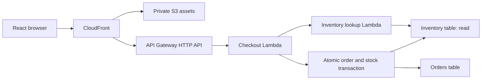

# Application

**Status: Current design.** This document owns the checkout application’s behavior and technical design. It records the accepted design, including presenter-only access through a shared password. Configured bounds do not establish achieved timing or capacity; measure those in the target environment.

The application is a small React page backed by TypeScript services in us-east-1. Successful checkout saves an order and updates inventory. It belongs to the [reference architecture](../../README.md), alongside the [failure controller](failure-controller.md) and [operations agent](operations-agent.md).

The application produces real operational evidence for the agent-evaluation talk. The audience sees checkout outcomes, failures, latency, and recovery; operating access is presenter-only. The failure controller changes real execution; the operations agent investigates ordinary evidence without receiving the intended diagnosis.

Application telemetry is the evidence the agent investigates. Agent traces are a separate record evaluated afterward. An evaluation may pass while the application remains faulty if the agent handles the incident correctly; see [evaluation approach](../evaluations.md).

## Architecture and rationale

Use API Gateway HTTP API, two TypeScript Lambda functions, two DynamoDB tables, and a React/Vite frontend on private S3 through CloudFront. CDK v2 in TypeScript defines the deployment. A generated shared password checked in the checkout handler controls presenter access.

| Concern | Choice | Reason |
| --- | --- | --- |
| Browser application | React, TypeScript, Vite, one page | Matches the preference and needs no server rendering or application router |
| Static hosting | Private S3 bucket and CloudFront | Familiar AWS components; one frontend origin with managed TLS |
| API | API Gateway HTTP API | Small set of routes, access logs, and request metrics; application checks the credential |
| Business handler | TypeScript Lambda on Node.js 24 | Request-scoped execution with explicit revision and runtime evidence |
| Controlled dependency | Separate read-only inventory lookup Lambda | Real independently timed lookup without a late-writing worker |
| Persistence | On-demand DynamoDB Orders and Inventory tables | Simple keyed records and atomic order/stock updates |
| Identity | Shared generated password; server check and fixed presenter principal | Presenter-only operating access without a separate authentication service |
| Telemetry | Structured CloudWatch logs, native metrics, a few embedded business metrics | Actual request and dependency evidence without another collector service |
| Change history | CloudTrail events plus actual function versions | Real change evidence distinct from private controller labels |
| Infrastructure | CDK v2, TypeScript, one application stack | One language and explicit reusable deployment |
| Local tooling | Node.js 24 and npm workspaces | Keep one package manager and lockfile; avoid another build orchestrator |

HTTP API lacks API Gateway X-Ray tracing. That is a deliberate limitation: request-ID joins and application timing satisfy the current evidence contract. Native traces can be added only if the selected observability demonstration actually needs them; sampled traces must not replace complete request logs. Choose REST API instead if full Gateway X-Ray is made a required demonstration capability.

The strongest complete alternative uses ALB, an ECS Fargate service containing checkout and read-only inventory containers, and RDS PostgreSQL. SQL would provide familiar transaction semantics, but the example would also need VPC/security-group setup, container artifacts, connection handling, credentials, and schema management. The Lambda/DynamoDB design has lower total burden for this bounded, intermittent demonstration. Primary sources are listed below.

## Component arrangement

The browser loads static assets through CloudFront. Its /api requests reach HTTP API and the checkout handler. The handler invokes the inventory lookup Lambda synchronously for a product snapshot and performs the final transaction itself.

The inventory function can read Inventory but cannot write orders or stock. The checkout handler can read orders and perform the required transaction on Orders and Inventory. These functions belong to one application and intentionally share a data model; they are not independent inventory and order microservices.

The lookup has a clear purpose: return server-owned product details, price, and current availability. The final stock condition remains authoritative because availability may change after the read. Keeping the dependency read-only means a slow invocation that outlives its caller cannot create a late order.

## Business scope

Start with one seeded product and a selectable quantity from 1 to 5. Show its name, a demo price, available stock, the checkout result, and recent browser request outcomes. This is a demonstration order flow: no payment collection, delivery, discounts, customer-profile system, shopping cart, or cancellation/refund workflow.

Use integer minor currency units for prices and totals. The browser submits product identity and quantity, never the authoritative price. An order records the product/price snapshot used at checkout. Seeded product details stay fixed within a run; the product data version changes when reset or reseeding invalidates an old snapshot.

The example stays limited to checkout and inventory. A custom incident-management UI, generic fault framework, and automatic remediation are outside this application’s scope.

## Browser behavior

The page shows the product, quantity control, current stock with a last-refreshed time, a checkout button, the last confirmed receipt, and a bounded history of its own requests. Each history row shows start time, outcome, end-to-end duration measured by the browser, and a server request ID when a response supplies one. On a lost response, retain the checkout identity, immutable input, local start time, and uncertainty; do not invent a server request ID.

Selecting checkout creates a new UUID for that logical attempt and captures the catalog's productVersion alongside sku and quantity. Store this immutable payload in session storage before sending it. Disable a second new checkout while that attempt is unresolved. Retrying an uncertain attempt keeps the same identity and input; changing the quantity starts a new logical attempt only after the previous outcome is settled. Reject an unavailable catalog version rather than inventing one. After a destructive reset, discard previous attempts, refresh the catalog, and create a new identity for any new checkout.

A confirmed success displays the saved order and refreshes stock. A failed stock refresh must not turn a confirmed order into a failed checkout. An out-of-stock result is a normal business rejection, distinct from a service failure. A lost response or uncertain write result prompts a status lookup and, if necessary, a same-ID retry; it must not claim no order exists merely because a request timed out.

The history describes requests made by this page. Controller-generated traffic is visible in CloudWatch and captured request records, not silently included in browser-only counts. Fault activation and hidden scenario names are kept out of the checkout UI and agent input.

## API contract

All routes use JSON. The handler validates inputs at runtime rather than relying on browser types. The routes are:

| Route | Input | Result |
| --- | --- | --- |
| GET /api/products | None | The seeded product, price, available quantity, data version, and observation time |
| POST /api/checkout | checkoutId UUID, sku, positive integer quantity and productVersion | Confirmed order receipt, or a classified rejection/failure |
| GET /api/orders/{checkoutId} | Stable checkout identity | Saved order for the authenticated principal, or not found |

The receipt includes checkoutId, sku, quantity, unitPriceCents, totalPriceCents, currency, createdAt, and status placed. Add the per-request requestId to the response envelope; it is not the durable order identity. Successful authentication establishes the fixed demo-presenter principal. All authorized presenters and controller requests share its orders; there is no individual-user isolation.

The inventory invocation accepts a lookup action, product identity or a bounded product-list request, and the originating request ID. It returns the product snapshot and its data version. Log the originating ID and the inventory Lambda's own request ID so the two operations can be joined. The caller checks Invoke's function-error field and validates its payload rather than treating a successful HTTP transport status as successful inventory lookup.

| Response | Meaning |
| --- | --- |
| 201 | New order saved and matching stock decrement committed |
| 200 on same-ID retry | Previously saved matching order returned; no new decrement |
| 400 | Invalid UUID, unknown fields, or invalid quantity/input |
| 401/403 | Authentication or authorization failure |
| 404 | Product or requested order not found |
| 409 | Insufficient stock, stale product snapshot, or same checkout identity with different input |
| 502 | Inventory invocation failed or returned an invalid payload |
| 504 | Inventory lookup exceeded the application's dependency deadline |
| 500 | Unexpected application error, with full details in logs and a safe public message |
| 503 with outcome unknown | The order transaction may have committed but its acknowledgement could not be confirmed |

Handler-generated errors contain a stable code, readable message, requestId, and checkoutId where applicable. Gateway pre-handler rejections use Gateway's own responses; the browser tolerates different envelopes and absent application request IDs. Distinguish a known pre-write failure from an unknown transaction outcome. Do not expose stacks, configuration, credentials, or injected-fault labels in responses.

## Persistence and consistency

Use two plainly named tables rather than a single-table design or relational database.

| Table | Key and fields | Use |
| --- | --- | --- |
| Inventory | sku; name, unitPriceCents, currency, availableQuantity, productVersion, updatedAt | Product snapshot, authoritative conditional decrement, and controlled reseeding |
| Orders | orderId derived from the fixed presenter principal plus checkoutId; ownerId, checkoutId, canonical request hash, product/price snapshot, quantity, total, createdAt, status | Saved receipt and durable duplicate protection |

Use on-demand capacity. No secondary index is needed for the chosen access patterns. There is no automatic order expiry during a run; explicit reset bounds the demonstration dataset. A list-all-orders or customer-history feature is outside this design.

Checkout follows this sequence:

1. Authenticate, validate input, derive orderId, and hash the canonical sku, quantity, and caller-supplied productVersion.
2. Strongly read Orders for that identity. Return a matching saved receipt immediately; return a conflict if the same identity belongs to different input.
3. Invoke inventory lookup with a bounded wait. Reject unavailable/invalid evidence and a snapshot version different from the caller's captured version before starting a business write.
4. Build one transaction: put the order only if absent, and update stock only if productVersion still equals the caller's captured version and sufficient quantity remains. Both changes commit or neither does.
5. On a duplicate race, strongly read the saved order and resolve it against the request hash. Distinguish stock/version rejection from transient transaction failure.
6. If acknowledgement is uncertain, attempt a bounded strong status read. Return the saved order if confirmed; otherwise report uncertainty and preserve the logical request ID for retry.

The inventory snapshot is not the authority for preventing overselling; the transaction condition is. The conditional order insertion prevents a retry, a concurrent duplicate, or a lost response from consuming stock twice while the record exists. DynamoDB's ten-minute ClientRequestToken window is not the business guarantee. If a token is used for SDK transport retries, all transaction parameters for that invocation remain frozen.

Product-version matching rejects a delayed transaction and an old browser payload invalidated by reset, even if the handler obtains a fresh snapshot afterward. The checkout identity and duplicate guarantee apply while the order record exists, within one demonstration run. Destructive reset ends that lifetime; previous attempts must not be reused. Reset requires a quiescent run with settled outcomes; the version guard does not make concurrent destructive reset safe.

## Incidents and version controls

Publish each checked application release with stable single-target aliases named `live` and an allowlist of qualified versions. The release-owned Inventory reserved-concurrency baseline is **16**; this is one function-level cap shared by its published variants, and Checkout remains unreserved. For Inventory, the release prepares healthy and denied baseline-memory variants from the same code and non-role settings; only the static execution role differs. The healthy role grants the normal read. The denied role retains logging/read access and carries a permanent explicit `dynamodb:GetItem` Deny on the exact Inventory table. Verify the original unpublished `$LATEST` configuration after publishing. A targeted capacity action may increase only Inventory's reserved concurrency; the bounded input starts at 32 and accepts integer targets from 16 through 64. A targeted memory action selects an Inventory variant, or an access action moves its `live` alias to an allowed version. Each reads back the selected configuration. Traffic controls remain separate.

| Scenario | Mechanism | Required observable behavior |
| --- | --- | --- |
| Healthy | Healthy code and aliases, Inventory at its release cap of 16, Checkout unreserved, and the healthy role-backed Inventory version at baseline memory | Product reads succeed; a checkout creates one order and matching stock decrement |
| `inventory-capacity-overload` | Keep app code, Inventory/Checkout memory, aliases, access, and the Inventory cap of 16 unchanged while running the finite saved `inventory_surge` profile through authenticated `GET /api/products`; Checkout probes remain sparse and bounded. | The live comparison must show actual Inventory caller rejection, positive native Inventory Throttles, lookup failures and the existing 502 before a checkout transaction, then rule out producer/upstream bottlenecks. After Stop/drain and the Inventory-only increase to 32, explicitly repeat the same saved version-2 profile. Compare actual offered demand and outcomes over separate windows; Recover later restores 16. A cap readback alone establishes configuration, not a throttle or recovery. |
| `inventory-access-denied` | Select the prepared denied baseline-memory Inventory version through the single-target `live` alias. Its static execution role retains logging/read access and carries the permanent exact-table `dynamodb:GetItem` Deny. Keep the checked code, release, memory and capacity settings unchanged. | The inventory execution records the access-denied read failure; the lookup returns the existing 502 response before a checkout transaction, and the API stage records 5xx. After the targeted access-restore alias action returns, separately issue an ordinary inventory read through the healthy version at the same memory; the request does not reselect the denied version. |
| Recovered/stale alert | Stop traffic and restore healthy aliases, the captured baseline capacity settings, and the healthy role-backed Inventory version at the baseline memory while retaining the original alarm/event context and incident evidence. | Fresh inventory reads and checkout succeed while older failure evidence remains available; an existing alarm may still be ALARM. This is a temporal recovery condition, not another injected fault. |

Inventory capacity overload may surface as throttling at the configured concurrent-execution cap or at the related synchronous Invoke requests-per-second limit. Compare the actual function cap, Lambda `Throttles`, child execution records, and API outcomes under comparable active catalog demand to identify and qualify the observed limiter; do not assert reserved-concurrency saturation without evidence. A rejected invoke does not execute the inventory function and therefore does not count as its `Invocations` or `Errors`, though it contributes to `Throttles`. An access-denied read does execute the inventory function and records the failed database operation. In both incidents, the checkout caller handles the failed lookup using the existing 502 response and does not start a business transaction.

Targeted setting actions only apply and read back the selected change. The capacity action targets Inventory only; Checkout remains unreserved. It validates the positive current cap and checks fresh AWS account settings and headroom, without calling Service Quotas. Its readback is separate from any later workload observation. Memory and allowlisted alias/version changes retain their existing constraints. These actions do not start or stop traffic, send business requests, or judge whether an incident has resolved. Report the configuration outcome separately from business behavior.

The controller's Inventory memory control selects an explicit supported size while retaining the same application artifact and non-memory settings. Deployment prepares healthy and denied variants at 256 and 512 MB and verifies that the original unpublished `$LATEST` configuration is restored. Published Lambda versions have immutable memory allocations, so the controller completes the action only by a revision-guarded `live` alias switch to an allowlisted current-release version. It does not stage `$LATEST`, publish versions, mutate function configuration, or change roles or policies. A memory switch preserves the current role/access state; restoring access selects the healthy variant at the current memory. An already-active size is a no-op, and unsupported or lower targets are rejected. Record and read back effective memory, code/version, role and alias revision separately from fresh request outcomes. See [Lambda published versions](https://docs.aws.amazon.com/lambda/latest/dg/configuration-versions.html).

Alias updates use the observed alias revision as a compare-and-swap guard and reconcile an uncertain response through alias readback. Existing invocations can overlap an alias switch, so configuration readback and fresh application requests remain separate evidence.

Capture the release-owned baseline cap of **16** for Inventory and the unreserved Checkout setting, along with baseline alias targets/versions, active-version memory sizes, the Inventory execution role and exact Deny policy identity/document/access state, and the absence of an Inventory table resource policy. Keep the original baseline at 16 separate from the controller-confirmed current Inventory cap and its observation time. Before recovery, capture the active alias/version/role/policy configuration in the private evidence record. The Phase 10 scenario compares the finite surge at the original and increased caps; a valid comparison requires measured demand and observed caller, native-metric, and business outcomes from both episodes. After a confirmed capacity action, same-generation Readiness may validate the raised current cap without changing original 16; a new generation must begin at its release baseline of 16. Only Recover and Reset restore Inventory to 16. The controller's private baseline record is used for restoration and is not agent evidence. The agent may see ordinary current selected memory/cap, alias/version/role/policy state, and management history, even when an observed value matches the private baseline record; it does not receive that record or controller labels.

The [scenario contracts](../demo-scenarios.md) specify each incident's activation, effects, evidence, expected agent handling, and recovery. The [controller specification](failure-controller-behavior.md) defines the operating controls; the [demo script](../demo-script.md) places their use in the talk. A recovered/stale-alert condition does not create a new fault or imply another live agent invocation.

Use the setup/deployer to publish the allowlisted healthy and denied Inventory versions, set the `live` aliases, set Inventory's reserved-concurrency baseline to **16**, verify Checkout remains unreserved and the original `$LATEST` configuration is restored, seed the tables, and capture exact version IDs and baseline settings. Publish the immutable version manifest in the existing CDK asset bucket and expose its location and denied-role ARN from the app stack. The controller reads that manifest and the qualified configurations, can increase only Inventory's reserved concurrency, select a prepared Inventory memory variant, or move the Inventory `live` alias by compare-and-swap to an allowlisted release/version. It has no IAM attach/detach, role-passing, `$LATEST` staging, version-publication, or other version-preparation authority. Each action reads back the selected configuration and reports its status without a business check. Controller permissions stay scoped to the named function's supported setting and alias changes. Incident activation selects the denied version without changing code, memory, or capacity; a memory action changes only the alias target and preserves the current Inventory access state.

## Timing and request bounds

Runtime values below are initial settings to verify in the deployed demo, not measured latency claims or service-level promises. The listed traffic profiles and action bounds describe controller behavior.

| Setting | Starting value |
| --- | --- |
| Inventory caller deadline | 1.5 seconds, one Invoke attempt |
| Inventory Lambda timeout | 6 seconds |
| Checkout Lambda timeout | 12 seconds, with time reserved for writes/status resolution |
| Browser request timeout | 15 seconds; preserve identity when the outcome is uncertain |
| Baseline Lambda memory/architecture | 256 MB, x86_64, no provisioned concurrency; memory increases use an explicit supported target |
| Inventory reserved-concurrency baseline | 16; the higher-cap action is Inventory-only |
| Checkout reserved concurrency | Unreserved; no Checkout capacity shortcut |
| Normal controller traffic | 15 seconds, with separate 1 Hz catalog and quantity-one checkout ticks; at most one catalog request and two checkout requests in flight |
| Catalog surge action | Authenticated `GET /api/products` under saved `inventory_surge` version 2: 30-request waves every 500 ms for 15 seconds (60 starts/second average), at most 900 attempts and 30 in flight, with a 7-second request timeout; these are requested bounds, not an achieved-rate guarantee |
| Access-denied activation | Up to six paced catalog probes, followed by at most one fresh checkout after a typed denial; bounded by the action deadline |
| Seed stock | 1,000 units, restored through explicit reset |

The catalog GET waves and checkout POST probes are separate workloads. Version 2 requests 30 catalog reads every 500 ms for 15 seconds (60 starts/second average), at most 900 attempts and 30 in flight. It also reserves and durably records up to 15 quantity-one checkout probes on one-second ticks, with at most one in flight and a 7-second timeout, before co-launching both producers. Missed, full-slot, or checkpoint-overlapping catalog waves are skipped; no queue or catch-up burst is allowed. Version 1 remains readable in prior action history and a replay of its action UUID returns its saved version; new actions select version 2. Calibrate and remeasure producer and upstream headroom for the target environment before comparing episodes. Actual fetch starts, wave cadence, skips, request-arrival times, one-second start cohorts, outcomes, and completion times determine offered demand; configured cadence and average rate do not. Inventory overload may appear as concurrent-execution or synchronous Invoke request-rate throttling; runtime evidence identifies or qualifies the observed reason. Sparse POST probes establish whether checkout fails before transaction writes. Apply each action's own rate, duration, attempt, concurrency, timeout, and deadline bounds; do not use a cumulative controller-wide request quota.

The checkout deadline must not be spent entirely waiting on inventory. SDK writes and status reads have a finite budget within the remaining handler time; do not start a transaction when the handler has insufficient time to handle its result. SDK retry configuration must be explicit and bounded, with idempotent transaction parameters. The exact transport retry/backoff settings are implementation details to tune against the approved total budget and deployed evidence.

A caller abort does not establish that an invoked Lambda stopped. Alias movement also does not drain existing invocations. Record overlap and determine scenario windows from actual versioned request evidence. Warm a baseline with bounded real traffic and distinguish cold-start effects from concurrency throttling.

## Operational evidence

Emit JSON logs with timestamp, environment, service, operation, requestId, Lambda request ID, actual function version/build revision, outcome, durationMs, status/error code, and relevant product/checkout identity. An executed Inventory `GetItem` denial adds `dependencyReason: inventory_access_denied` to the existing authenticated `502 INVENTORY_LOOKUP_FAILED`. An SDK-shaped Invoke throttling rejection keeps the generic public failure response and adds the bounded SDK `Reason` as `dependencyThrottleReason` to the structured Checkout log. The child log records the DynamoDB operation, table ARN, exception name, and the service request ID when available. Join it to the Checkout and Gateway logs by the Gateway request ID. The caller retains the executed child version from Lambda when available; an Invoke rejected before execution has no child execution/version to report. The failed child still emits a Lambda function error when it actually ran. Log dependency start/completion, throttle rejection, or timeout with the originating request ID, requested alias, actual executed version when known, and dependency duration. Never claim a resolved child version when only the requested alias is known.

Use separate log groups for HTTP API access, checkout, and inventory. Gateway access records include request ID, route, status, `requestTimeEpoch`, and integration latency. Use `requestTimeEpoch` as the request-arrival time for cohort/source-arrival analysis; keep it distinct from the log event timestamp and the later evidence acquisition/observation time. Application logs are the complete per-request investigation record. Do not log tokens, Authorization headers, or private fault-controller labels.

Native Gateway metrics cover request count, 4xx/5xx, and latency; Lambda metrics cover function invocations/errors/duration. Add low-cardinality embedded metrics for checkout success/server failure and inventory lookup duration/timeouts. Dimensions are environment and service, not request IDs or order IDs. A handled HTTP error response does not necessarily increment Lambda Errors, so the agent must be able to inspect business outcomes and Gateway status rather than infer health from Lambda Errors alone.

CloudTrail management events and actual function versions establish deployment and selected-configuration history. Normalize relevant alias, reserved-concurrency, version-publication, and deployment-owned role/policy changes for the agent's read-only deployment tool. Expose ordinary timestamps, resources, alias targets, numeric versions, revision hashes, and the current selected cap/memory/role/policy state needed to investigate. Exclude the private baseline record/manifest and controller-only descriptions or fault-labelled metadata; do not remove ordinary current or historical configuration evidence merely because a value also appears in the private baseline. Exclude code contents and unrelated configuration, and do not pass raw function-configuration or IAM policy responses to the agent. Event history may arrive later than request logs; the demonstration must verify availability before depending on it. There is no requirement for a new CloudTrail Lake store or data-event trail.

Retain application logs for 14 days during preparation and the two sessions. Export the reviewed synthetic evidence needed for slides and cases before retention removes it. Missing metric intervals or pending log ingestion must remain missing evidence, not reported healthy values.

## Application alarm

The app stack provisions one native CloudWatch alarm for API server errors, `IncidentTriageDemoAppStage5xx`. It publishes its name and ARN for the controller. The alarm observes the same stage regardless of the cause. The stack accepts an optional adapter ARN from the independently deployed agent stack: while unbound, alarm actions remain disabled; after the adapter has passed native release finalization, the app release enables the alarm action to invoke that adapter. Keep the alarm's identity, dimensions, and threshold unchanged when wiring it.

| Setting | Value |
| --- | --- |
| Namespace / metric | `AWS/ApiGateway` / `5xx` (HTTP API spelling) |
| Dimensions | Actual deployed `ApiId` and `Stage` in us-east-1 |
| Statistic / period | `Sum` / 60 seconds |
| Comparison / threshold | `GreaterThanOrEqualToThreshold` / `1` |
| EvaluationPeriods / DatapointsToAlarm | `1` / `1` |
| TreatMissingData | `notBreaching` |
| Evaluation window | Default sliding window |
| Unit | Omit; use the published metric's unit |

This covers the existing 502 responses from inventory lookup failures in both incidents. A completed failing probe can supply a breach without extending the finite traffic batch. Logs, actual execution versions, Lambda throttle metrics, access-denied records, and ordinary configuration history distinguish causes. The stage-level signal includes every route and caller of this demo API, including catalog failures; it is not a controller-only or checkout-only count. Authentication/validation 4xx responses do not meet this threshold. Do not infer the scenario from the alarm alone.

HTTP API supplies the metric at one-minute granularity. Use the stage aggregate without enabling route-level detailed metrics for this alarm. Keep latency/dependency metrics as diagnostic evidence. Native Gateway measurement avoids a new failure-metric publisher and still observes server errors if application instrumentation fails. [HTTP API metrics](https://docs.aws.amazon.com/apigateway/latest/developerguide/http-api-metrics.html)

One breaching period fits the short bounded demonstration. Requiring multiple breaching minutes could miss a run contained in one minute. A high-resolution custom failure metric could shorten aggregation, but adds instrumentation/extraction coverage across deployed versions and still needs delivery-time verification. Choose the native alarm's lower implementation/operating burden because visible monitoring lag is acceptable. This sensitive threshold is specific to the demo. [Metric resolution](https://docs.aws.amazon.com/AmazonCloudWatch/latest/monitoring/publishingMetrics.html)

`notBreaching` avoids alarming solely because traffic is idle. **OK does not prove health:** an active fault with no requests, or missing telemetry, can eventually show OK. Retain independent fresh-request readiness and observation freshness. Default sliding evaluation can reuse older actual datapoints when newer ones are missing, so failures may keep ALARM despite recovery. Success does not subtract errors from a breaching period. Wait for observed OK before the next fresh incident; do not promise detection or clearing within exactly 60 seconds. [Missing-data evaluation](https://docs.aws.amazon.com/AmazonCloudWatch/latest/monitoring/alarms-and-missing-data.html)

Verify metric dimensions, healthy readiness, each fault's real ALARM transition, and eventual OK after recovery within the selected finite traffic actions. Record actual request-to-alarm and recovery-to-OK times before assigning rehearsal waits. After the agent release verifies MMDSv2 and reads back its final pinned endpoint and adapter attestation, bind the adapter ARN through a separate app-stack release. The controller independently observes the alarm and binding but never publishes replacement metrics, invokes the agent, or forces alarm state. [Alarm parameters](https://docs.aws.amazon.com/AmazonCloudWatch/latest/APIReference/API_PutMetricAlarm.html)

Only a real CloudWatch transition to ALARM starts this path. The Lambda adapter validates and forwards the delivered event; AgentCore Runtime conditionally creates the one `running` record keyed by the alarm ARN and normalized originating transition time. Preserve the verbatim event and final checked deployment identity with the investigation. A later alarm read or dashboard poll is an observation, not a replacement event or invocation. The [agent design](operations-agent.md) owns the event identity and run claim, and the [controller specification](failure-controller-behavior.md) defines durable discovery and display.

## Frontend hosting and access

CloudFront serves the private S3 asset origin using OAC and HTTPS. Use its generated domain and managed TLS; no custom domain or ACM certificate is needed. Cache hashed assets, make the HTML/config revalidatable, and keep /api responses uncached. The API origin policy must preserve authentication headers while substituting Gateway's expected Host header. Keep error responses on /api distinct from the frontend index page.

Use one generated high-entropy shared password for presenter-only access. The static HTML/JavaScript can be publicly accessible because the code is also public; the operating API and its data require the credential.

The browser presents a password form, holds the entered credential in memory, and sends it in the Authorization header as a bearer credential over HTTPS. Authenticate by loading the protected catalog. Reloading the page requires re-entry; logout clears the in-memory credential. Pending checkout identity/input can remain in session storage for reconciliation after re-entry, but the password does not. Do not put the password in frontend assets, URLs, repository files, or logs.

The checkout Lambda checks every business request before routing, dependency calls, or writes. Configure only a SHA-256 digest of the generated random password in its deployment environment; hash the received credential and compare fixed-length digests with Node's timingSafeEqual. Missing or invalid credentials return 401, and missing/invalid server configuration fails closed. All successful requests use the fixed demo-presenter principal; shared access intentionally provides no individual-user permissions or revocation.

Use the same entry guard in every published checkout version. Direct calls to Gateway still reach the guard; protecting CloudFront alone would leave the API exposed. Preserve Authorization forwarding and disable API caching. The local comparison needs no network call or additional Lambda invocation; end-to-end timing still includes it.

The cloud controller backend will read the presenter bearer from its private cloud credential store and send the same Authorization header to the protected business routes. Its presenter web interface does not receive AWS credentials; the precise private credential-entry flow is an implementation detail. It cannot assume access to the checkout page's in-memory credential. Do not pass the password as a command-line argument, store it in browser storage, or write it to a run record. Fault activation and data reset require privileged AWS permissions separate from the demo password; they are not business API routes.

Rotating the password requires a setup run that republishes every usable Checkout version with the new digest and credential generation and updates the live alias and the controller credential. Previously published version configuration is immutable; updating only the latest handler is insufficient. The setup script must verify that active versions reject the old credential. Do not rotate credentials during a timed scenario.

A separate API Gateway Lambda authorizer is an alternative if authentication must be independent of business revisions or centrally rotated more often; it adds a function, permissions, and invocation/cache behavior. Cognito remains the alternative for individual accounts, separate order ownership, individual revocation, or managed sign-in. Neither is required by the current shared presenter-only demo. The shared credential grants everyone who holds it the same presenter access.

## Deployment, development, and reset

The React page and the Checkout and Inventory Lambda entries live in `app/src`. CDK is in `infrastructure/app`, and deployment support commands are in `scripts`. Share only the small request/response types and schemas that callers actually need. Do not introduce a generic service framework, workflow engine, plugin system, or monorepo orchestrator.

The development host uses Node.js 24, a single npm lockfile, TypeScript type checking, Vite for the web build, esbuild-backed CDK Lambda bundling, and explicitly bundled AWS SDK v3 modules. Versions are pinned during implementation; production does not follow a latest-runtime alias. Develop the React page locally against the deployed AWS API with a dev proxy and the privately supplied demo credential, rather than requiring a cloud emulator.

[GitHub Actions](../deployment.md) builds, checks, and automatically deploys relevant changes from `main` to the shared development environment. CDK remains the infrastructure definition. Routine deployments preserve Orders/Inventory; initial data setup and presenter-operated reset are separate operations.

Schedule deployments outside active demo runs. Bind the controller baseline to the successful app release and its deployed artifact identity. If a deployment overlaps a demo, abandon that run and verify the deployed release and affected live settings before starting another. See the [deployment procedure](../deployment.md#deployment-and-controller-baseline).

After deployment, check actual versions, settings, and access state against the successful release before adopting its baseline. A failed or partial deployment requires reconciliation before controller actions resume. Routine deployment preserves Orders and Inventory. Run demo probes, Recover, and Reset separately from deployment.

CDK defines one application stack with the functions, aliases, tables, hosting, IAM, and logs. Runtime functions need no VPC or NAT. Separate runtime permissions from the deployer/controller: Inventory reads Inventory; Checkout invokes its lookup and performs the declared data operations; deployment prepares the allowlisted version/role combinations and verifies the original `$LATEST` settings; the controller can increase only Inventory's reserved concurrency, select an Inventory memory variant, perform the supported Inventory alias operation, drive bounded traffic, and reset the selected dataset. The capacity worker reads fresh regional account settings to check headroom; runtime has no Service Quotas API call. Memory actions preserve code and all other configuration, including the current Inventory access state. It records actual settings, alias/version, role and policy state for comparison with known expected values bound to a trusted deployment generation, and restores only an eligible baseline after a generation check. The controller has no IAM attach/detach, role-passing, `$LATEST` staging, version-publication, or other version-preparation authority. The operations agent gets read-only investigation access through its separately designed tools, not fault activation or business write authority.

Initial setup deploys the resources with the authentication digest and publishes the allowlisted healthy/denied Inventory variants, restoring and verifying the original `$LATEST` settings afterward. Seed the demo SKU separately with `node scripts/seed-app-inventory.mjs`. Use the site URL from the stack outputs to verify one normal order and the matching stock change before rehearsal. The [deployment procedure](../deployment.md#first-app-release-and-presenter-access) covers first release and local development against the deployed API.

Reset is a privileged presenter-controlled procedure with these preconditions and steps:

1. Require explicit confirmation that the presenter wants the destructive reset, traffic is quiet, and old checkout pages are closed. Stop both controller producers and do not accept new work.
2. Wait for accepted controller work and its execution/drain window to settle. Reconcile known checkout IDs through status without resubmitting their POSTs. An outcome that remains unknown stays unknown in the old run; once its execution and drain window have ended, that archived unknown does not by itself prevent a newly confirmed reset. Do not reset while old work could still write.
3. Validate the current successful app release and exact target resources. Reconcile aliases, baseline memory, Inventory cap 16, Checkout's unreserved setting, and healthy access against that release's trusted expected settings, even when the saved old baseline is stale or missing. Do not restore an older release over a newer one. A failed or partial deployment, or unknown target/configuration state, blocks destructive work until reconciled. This is separate from Recover, which requires its saved baseline to match the current deployment generation.
4. Preserve the quiescent prior run, receipts, request outcomes, unresolved checkout identities, action references, incident/source captures, and agent results. Archive it before changing business data. The Reset action's UUID becomes the new run ID and links to the prior run. The new run starts with reset required until verification finishes.
5. While writers remain paused, conditionally replace only the canonical SKU with its established name, price, and currency, stock 1,000, and a newly generated UUID `productVersion`. Then scan every Orders page and delete the old order keys. Verify no prior orders remain. The version change rejects stale checkout payloads; it does not make concurrent reset safe.
6. Clear or refresh checkout pages and their pending attempts with presenter acknowledgement. Verify a catalog read at the new version and stock 1,000, place one new quantity-one order, read its saved receipt through status, and verify the same product version now has stock 999. Record this order and decrement in the new run's baseline. Retain old run history through the previous-run link and authenticated `GET /api/runs/{id}` reads.
7. Leave traffic stopped after success; the presenter starts it only through a separate explicit action. If Reset is interrupted, keep the run unusable and ordinary operations blocked. After the old execution/drain window and any needed explicit discard, start a new confirmed Reset with a fresh action UUID and productVersion. Do not continue the old action, reuse its ID, or resume from a reset journal; preserve any old unknown outcome as unknown.

The verification checkout remains a normal saved order, so the new state is stock 999 with that receipt, not pristine seed stock or an empty Orders table. Case assertions compare order and stock changes against this recorded baseline. Recover remains data preserving and follows its strict saved-baseline generation check.

Use on-demand resources and bounded traffic. There is no always-running compute service, database instance, load balancer, or NAT gateway in this design. CloudFront, storage, logs, metrics, identity, requests, and execution can still incur charges; do not describe the deployment as free or infer a cost without its usage/pricing basis. Teardown removes the selected demonstration stack and data only after required evidence has been exported.

## Verification required for implementation

Verification should prove the behavior, not only infrastructure creation or a successful build:

- A normal browser checkout creates one order and the corresponding stock decrement, with investigateable evidence.
- Two concurrent attempts to consume the last available stock cannot both succeed, and stock cannot become negative.
- Repeated and concurrent matching checkout IDs create one order/decrement; reusing the identity for different input is rejected.
- A lost commit acknowledgement can be reconciled without claiming failure or double-consuming stock; a saved same-ID retry succeeds even when a later inventory lookup fails.
- Phase 10's separately started or repeated catalog workload at comparable demand shows actual Lambda throttles and lookup failures before the cap change, identifies whether concurrency or synchronous request-rate throttling occurred, and shows whether failures recur with the current post-fix cap. The Phase 9 scoped action reports only Inventory's selected-setting result; full Recover and Reset restore its release baseline cap of 16.
- The prepared denied Inventory version produces a real access-denied read failure through the permanent exact-table `GetItem` Deny; its restore action reports the alias/version/role/policy readback, and a separate ordinary inventory request through the healthy version at the same memory shows whether reads work again without selecting the denied version. Both incidents return the existing 502 before checkout mutation.
- Recovery stops traffic, settles outcomes, and restores aliases, baseline capacity settings, and the healthy role-backed access state at the baseline memory. Its fresh business verification remains separate from the incident fix action.
- A confirmed order stays confirmed when the subsequent stock-refresh request fails.
- Alias and request records identify actual versions; no hidden scenario labels reach agent evidence.
- A stale immutable checkout payload is rejected after reset; reset requires stopped traffic and settled outcomes, restores real behavior, and leaves enough old/new evidence to investigate a stale alert correctly.
- Every published checkout variant rejects missing/invalid credentials on every business route, including direct Gateway calls. Authentication happens before dependency calls and mutation; browser/controller share the documented presenter ownership. No credentials appear in logs or static assets.
- Public setup and teardown instructions can reproduce the chosen deployed environment and clean it up.

No verification above has been executed; these are the intended implementation checks. The application does not need agent evaluators to prove its own business invariants.

## Remaining implementation details

The design above is sufficient to start implementation when requested. Exact package versions, handler schemas, SDK retry/backoff values within the defined budgets, resource identifiers, and executable setup/reset commands are selected and verified during implementation. Do not present commands or performance results as available before they exist.

The controller's action/read semantics and private record contents are defined in its specification; exact executable routes/types remain implementation details. The agent design defines its alarm adapter, Runtime hosting, and run/report storage. Exact tool schemas and model selection, evaluator rubrics and release thresholds, and checkpoint packaging belong to their respective component designs. The controller's local hosting is selected. This application document defines their required boundaries and evidence sources without choosing those remaining details.

## Primary sources

The following official documentation supports the platform behavior used in this design. The application architecture, initial settings, and access tradeoffs are project decisions, not measured AWS performance claims.

- [DynamoDB transaction semantics](https://docs.aws.amazon.com/amazondynamodb/latest/APIReference/API_TransactWriteItems.html) and [strong read consistency](https://docs.aws.amazon.com/amazondynamodb/latest/developerguide/HowItWorks.ReadConsistency.html).
- [Lambda published versions](https://docs.aws.amazon.com/lambda/latest/dg/configuration-versions.html), [aliases](https://docs.aws.amazon.com/lambda/latest/dg/configuration-aliases.html), and [version-specific environment configuration](https://docs.aws.amazon.com/lambda/latest/dg/configuration-envvars.html).
- [Synchronous Lambda invocation](https://docs.aws.amazon.com/lambda/latest/dg/invocation-sync.html) and [Invoke payload/error semantics](https://docs.aws.amazon.com/lambda/latest/api/API_Invoke.html).
- [HTTP API capabilities and REST comparison](https://docs.aws.amazon.com/apigateway/latest/developerguide/http-api-vs-rest.html), [access-log fields](https://docs.aws.amazon.com/apigateway/latest/developerguide/http-api-logging-variables.html), and [metrics](https://docs.aws.amazon.com/apigateway/latest/developerguide/http-api-metrics.html).
- [Lambda metric definitions](https://docs.aws.amazon.com/lambda/latest/dg/monitoring-metrics-types.html) and [CloudTrail management events](https://docs.aws.amazon.com/lambda/latest/dg/logging-using-cloudtrail.html).
- [Private S3 access through CloudFront OAC](https://docs.aws.amazon.com/AmazonCloudFront/latest/DeveloperGuide/private-content-restricting-access-to-s3.html) and [origin request policies](https://docs.aws.amazon.com/AmazonCloudFront/latest/DeveloperGuide/using-managed-origin-request-policies.html).
- [Lambda runtimes](https://docs.aws.amazon.com/lambda/latest/dg/lambda-runtimes.html), [CDK TypeScript](https://docs.aws.amazon.com/cdk/v2/guide/work-with-cdk-typescript.html), [NodejsFunction bundling](https://docs.aws.amazon.com/cdk/api/v2/docs/aws-cdk-lib.aws_lambda_nodejs-readme.html), and [Vite](https://vite.dev/guide/).
- [Node timingSafeEqual](https://nodejs.org/api/crypto.html#cryptotimingsafeequala-b); alternative [HTTP API Lambda authorizers](https://docs.aws.amazon.com/apigateway/latest/developerguide/http-api-lambda-authorizer.html) and [Cognito authorization with PKCE](https://docs.aws.amazon.com/cognito/latest/developerguide/authorization-endpoint.html).
